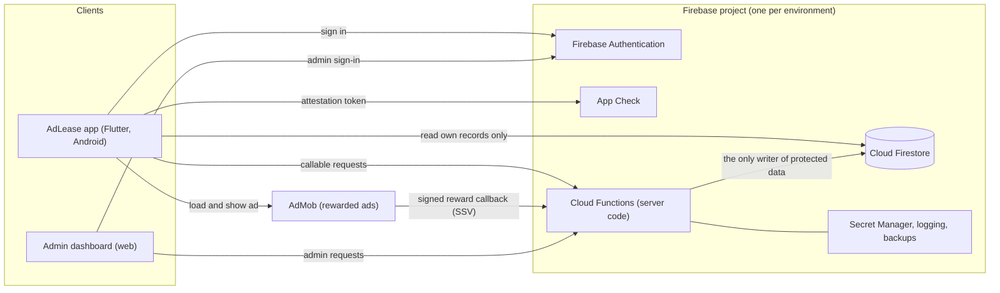
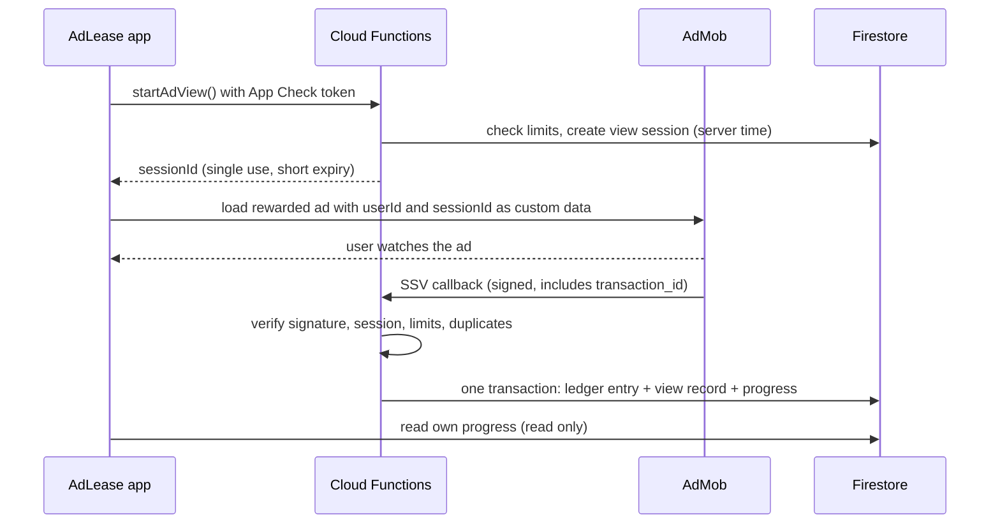

# Proposed architecture and data flows

> Status: **proposed**. Nothing described here is built or deployed.

## Principle

**The phone may ask; only the server decides.** The app and the admin
dashboard never write balances, ad-view records, rewards, limits, roles or
verification status directly. They call server code, which checks the request
and records the result.

## Components

| Component | Responsibility | Must not |
|---|---|---|
| AdLease app | Sign-in, show ads, show the user's own records, send requests to server code | Write rewards, balances, limits, view records or account flags; hold secrets |
| Firebase Authentication | Identity: who the user or admin is; account recovery | Be the place roles are decided by the client |
| App Check | An additional abuse-prevention layer: helps reject requests that do not appear to come from the genuine app on a genuine device (Play Integrity on Android). It can be bypassed | Be treated as a guarantee or as complete fraud protection on its own |
| Cloud Functions | All writes to protected data: account creation, ad-view sessions, SSV verification, reward crediting, limits, referrals, admin actions, audit log | Trust any amount, timestamp or "completed" flag sent by the app |
| Cloud Firestore | Stores accounts, ownership progress, ledger, view records, configuration, audit log | Accept client writes to protected collections (enforced by security rules) |
| Admin dashboard | Read-only views and admin actions through server code | Write to the database directly; be reachable without admin sign-in |
| AdMob | Serves rewarded ads; sends a signed server-side verification (SSV) callback per completed view | Be the source of the reward amount (the server decides that) |
| Secret Manager, logging, backups | Server-only secrets, audit and operational logs, database backups | Store secrets in the repository or the app |

Data location: the preferred Firestore location is `africa-south1`
(Johannesburg). **Unverified**: Google lists this location for Firestore in
Datastore mode; it must be confirmed for Firestore Native mode when the
project is created. Any location is outside Kenya, which has data-protection
consequences (see [open-decisions.md](open-decisions.md)).

## Data flows

### 1. Sign-up and sign-in

1. The app signs the user in with Firebase Authentication (method is a
   decision; phone number is the likely default).
2. A server function runs when the account is first created and creates the
   `users/{uid}` document with server-set fields (`createdAt`, `isVerified`,
   `isActive`, `referralCode`).
3. The app may then update only the fields the user is allowed to change (see
   [firestore-rules-review.md](firestore-rules-review.md)).
4. Local accounts and password hashes in SharedPreferences are no longer
   used. Because all current on-device data is demo data, the proposal is to
   start fresh rather than migrate it (**decision needed**).

### 2. Watching a rewarded ad

The app's own "the ad finished" event is used only to update the screen. A
reward exists only after the server has verified the SSV callback. Full rules
are in [reward-rules.md](reward-rules.md).

### 3. Reading balances and progress

The app reads the signed-in user's own documents (ownership progress, ledger
entries, view history). Security rules allow reading only documents whose
owner is the signed-in user, and allow no writes to them.

### 4. Admin actions

1. An admin signs in to the dashboard with Firebase Authentication and
   two-factor authentication.
2. The dashboard calls admin functions. Each function checks the caller's
   admin role (a custom claim set only by server code), performs the action
   and writes an audit-log entry in the same operation.
3. The dashboard never writes to Firestore directly. Details are in
   [operations.md](operations.md).

### 5. Referrals

Referral relationships are recorded only by server code, when a new account is
created with a referral code. No referral reward is promised or credited until
the referral reward rules are decided (**decision needed**). The app currently
mentions a referral bonus that nothing pays; that text should be removed in a
separate pull request.

## Out of scope

Payouts and withdrawals (switched off in the app and dashboard), payment
integration (for example M-Pesa), partner integrations (for example M-KOPA)
and the Avaru promotional videos are **not** part of this architecture until
separately approved. If Avaru house ads are added later, they MUST NOT create
rewards, ledger entries or ad-revenue records.
